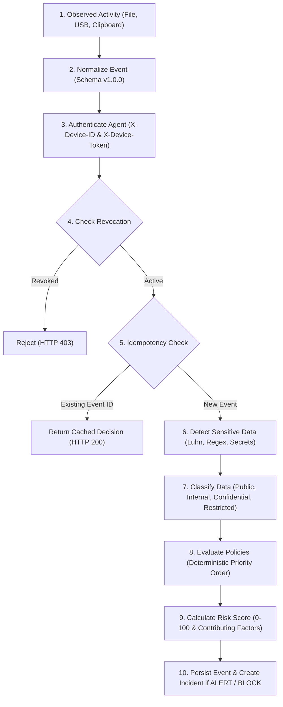

# DLP Endpoint Agent Operator & Architecture Guide

## 1. Overview & Architecture

The **DLP Endpoint Agent** is a lightweight, defensive endpoint security service designed for authorized corporate endpoints (Linux and Windows). It operates transparently to observe data-handling activities across configured storage directories, removable storage devices (USB), and an optional, explicitly enabled clipboard channel.

The agent communicates with the central **DLP Defender** server over authenticated HTTPS/HTTP API v1 endpoints.

```
+-------------------------------------------------------------------------------+
|                             Endpoint Host Machine                             |
|                                                                               |
|  +---------------------+   +---------------------+   +---------------------+  |
|  |    File Observer    |   | Removable Media USB |   | Clipboard (Opt-in)  |  |
|  | (Configured Dirs)   |   | (Mount Detect/Copy) |   | (Disabled by Def.)  |  |
|  +----------+----------+   +----------+----------+   +----------+----------+  |
|             |                         |                         |             |
|             +-------------------------+-------------------------+             |
|                                       |                                       |
|                                       v                                       |
|                       +-------------------------------+                       |
|                       |   Agent Service Orchestrator  |                       |
|                       +---------------+---------------+                       |
|                                       |                                       |
|                                       v                                       |
|                       +-------------------------------+                       |
|                       |   Bounded Durable Disk Queue  |                       |
|                       |      (agent_queue.json)       |                       |
|                       +---------------+---------------+                       |
|                                       | (Flush with Retries)                  |
|                                       v                                       |
|                       +-------------------------------+                       |
|                       |    Authenticated API Client   |                       |
|                       |  (X-Device-ID, X-Device-Token)|                       |
+---------------------------------------+---------------------------------------+
                                        |
                                        v (HTTPS / TLS)
+-------------------------------------------------------------------------------+
|                             Central DLP Platform                              |
|   - Ingestion Pipeline: Detectors -> Classification -> Policy -> Risk Engine  |
|   - Storage & Triage: EndpointEvent -> Incident -> Audit Trail                |
|   - Admin Dashboard: Endpoint Inventory & Event Explorer                      |
+-------------------------------------------------------------------------------+
```

---

## 2. Non-Negotiable Privacy & Safety Guarantees

1. **Strictly Visible:** The agent runs as a transparent user-space background service or process. It contains no rootkit hooks, stealth persistence, credential harvesting, or AV evasion mechanisms.
2. **No Keystroke Logging:** The agent does not intercept keystrokes or monitor keyboard inputs under any circumstances.
3. **Clipboard Opt-In Only:** Clipboard observation is **disabled by default**. It requires explicit administrator configuration (`"monitor_clipboard": true`). When enabled, only a minimal sample is analyzed and raw memory strings are discarded immediately.
4. **Data Minimization:** Whole files are never exfiltrated to the server. The agent transmits event metadata, cryptographic SHA-256 hashes, and bounded text samples (truncated to 100 KB max). The server performs regex detection and permanently stores only redacted finding representations (e.g. `4532-****-****-5671`).
5. **No Blind Enforcement Claims:** The policy decision `BLOCK` is accurately reported as `NOT_ENFORCED` at the OS level unless a proven user-space enforcement hook (such as read-only file quarantine) is active. The prototype never claims kernel-level or network-level inline blocking.

---

## 3. Configuration & State Files

The agent maintains two state files in its deployment directory:

### `agent_config.json`
Configuration file storing server credentials and monitoring scopes:
```json
{
  "server_url": "http://localhost:5000",
  "device_id": "ep-45e645478abf4afb",
  "agent_token": "tok_sec_b97c0da9f921d2be11adfa70f80bc...",
  "hostname": "workstation-alpha",
  "os_name": "Linux",
  "monitored_paths": [
    "/home/user/Documents/DTS/monitored_data"
  ],
  "monitor_removable_media": true,
  "monitor_clipboard": false,
  "max_file_size_bytes": 5242880
}
```

### `agent_queue.json`
Bounded on-disk FIFO buffer providing offline resilience during network outages:
- Maximum default queue size: 500 events (configurable).
- Oldest events are dropped on overflow to avoid unbounded disk exhaustion.
- Delivered events are acknowledged and pruned atomically.

---

## 4. CLI Usage & Subcommands

The agent provides a command-line utility located at [`scripts/run_agent.py`](file:///home/robin/Documents/DTS/scripts/run_agent.py).

### Subcommands

#### 1. Enroll Device
Registers this endpoint with the central DLP platform and retrieves device credentials:
```bash
python scripts/run_agent.py enroll [--server-url http://localhost:5000]
```
Output:
```
[*] Enrolling device 'workstation-alpha' with DLP server at http://localhost:5000...
[+] Enrollment successful!
    Device ID   : ep-45e645478abf4afb
    Agent Token : tok_sec_... (saved securely to agent_config.json)
```

#### 2. Check Device Status & Server Connectivity
Inspects local configuration, queue depth, and issues a live heartbeat ping:
```bash
python scripts/run_agent.py status
```
Output:
```
========================================
       DLP Endpoint Agent Status        
========================================
Config File       : /home/robin/Documents/DTS/agent_config.json
Server URL        : http://localhost:5000
Hostname          : workstation-alpha
OS Platform       : Linux
Device ID         : ep-45e645478abf4afb
Enrolled          : YES
Monitored Paths   : /home/robin/Documents/DTS/monitored_data
USB / Removable   : ENABLED
Clipboard (opt-in): DISABLED (Default)
Queued Events     : 0 event(s) pending
[*] Testing server connectivity and heartbeat...
[+] Server Connection : ONLINE (Status: OK)
========================================
```

#### 3. Run Monitoring Daemon
Runs the agent service loop (polls observers every 2 seconds, flushes queue, and heartbeats every 30 seconds):
```bash
python scripts/run_agent.py run [--poll-interval 2.0] [--enable-clipboard]
```

#### 4. Generate Synthetic Test Event
Submits a synthetic event directly to the pipeline for verification without modifying real system files:
```bash
# Benign file event:
python scripts/run_agent.py test-event --type file

# Sensitive USB event with test credit card:
python scripts/run_agent.py test-event --type usb --sensitive
```

---

## 5. Event Ingestion Pipeline

When an observer emits an event, the server executes the following deterministic 10-step pipeline:



---

## 6. Uninstall & Decommissioning

To uninstall the agent:
1. Stop the running process (`Ctrl+C` or `kill <pid>`).
2. Remove configuration and queue files:
   ```bash
   rm -f agent_config.json agent_queue.json
   ```
3. In the central management dashboard, an administrator can mark the device as **REVOKED** under **Endpoints** -> **Device Detail** -> **Revoke Device**.
